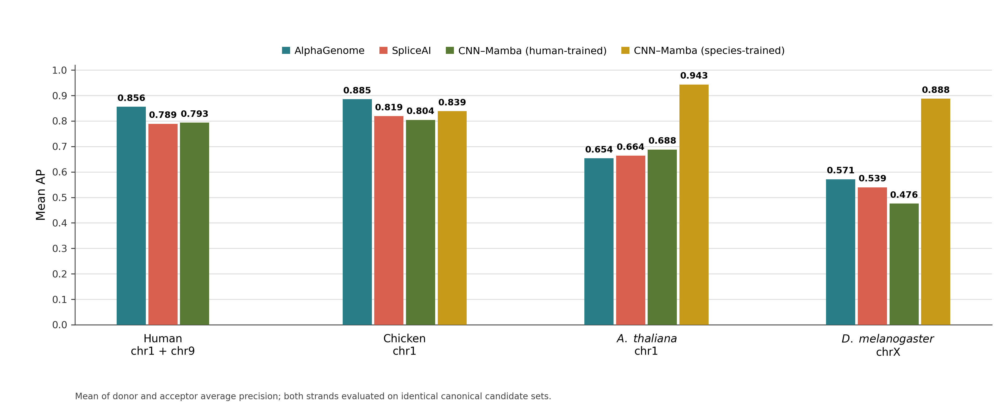

# Species-Specific Splice Site Prediction with a Hybrid Convolutional and Bidirectional Selective State Space Model

[](https://doi.org/10.5281/zenodo.24460070)

Train and evaluate splice-site predictors that combine local convolutional
features with bidirectional selective state space layers. This repository
contains the splice-only CNN--Mamba-k7 implementation, exact four-species
benchmark definitions, compact result tables, checkpoint metadata, and
publication figures. Large sequence data, training windows, checkpoints, and
per-site score tables are tracked by SHA256 but excluded from Git.

## Abstract

Accurate prediction of splice sites is essential for ab initio gene finding
and for validating transcripts assembled from RNA-seq data. However,
distinguishing functional splice sites from the vast number of similar
sequence motifs in the genome remains a major computational challenge. We
present a model that combines convolutional layers with a bidirectional
selective state space model (SSM) to predict donor and acceptor splice sites.
The convolutional layers extract local sequence motifs, while the
bidirectional SSM layers integrate upstream and downstream sequence context
with time and memory costs that scale linearly with sequence length, allowing
the model to be trained on a single consumer GPU.

We trained separate models on datasets derived from reference annotations for
human, chicken, *Arabidopsis thaliana*, and *Drosophila melanogaster*, and
evaluated them on held-out chromosomes. On human, our model performed
comparably to SpliceAI (average precision 0.793 versus 0.789) but below
AlphaGenome (0.856). On the separate April-16 shared-candidate subset of chr1
and chr9, the architecture-matched CNN--Mamba model reached 0.934, compared
with 0.932 for AlphaGenome's raw probability and 0.918 for SpliceAI. In
*Arabidopsis* and *Drosophila*, models trained on
species-specific data achieved the highest average precision (0.943 and
0.888), far exceeding SpliceAI and AlphaGenome applied without retraining (at
most 0.664 and 0.571). In chicken, the species-trained model (0.839) exceeded
SpliceAI (0.819) but not AlphaGenome (0.885). A human-trained version of our
model applied to the same species performed similarly to SpliceAI, indicating
that the gains in *Arabidopsis* and *Drosophila* derive mainly from
species-specific training rather than from the architecture itself.

These results suggest that a lightweight convolutional and selective SSM
model, retrained on each species' reference annotations, provides a practical
approach to splice site prediction in species to which models trained on
human data transfer poorly.

> Provenance correction: the initially supplied `0.920` April-16 SSM value
> came from a historical pure-Mamba checkpoint. The abstract above uses the
> architecture-matched CNN--Mamba-k7 reanalysis (`0.934`). See
> [result provenance](docs/RESULT_PROVENANCE.md).

## Main result



Mean AP is the arithmetic mean of donor and acceptor AP on both strands.

| Species | AlphaGenome | SpliceAI | Human-trained CNN--Mamba | Species-trained CNN--Mamba |
|---|---:|---:|---:|---:|
| Human | **0.856** | 0.789 | 0.793 | -- |
| Chicken | **0.885** | 0.819 | 0.804 | 0.839 |
| *A. thaliana* | 0.654 | 0.664 | 0.688 | **0.943** |
| *D. melanogaster* | 0.571 | 0.539 | 0.476 | **0.888** |

Exact donor and acceptor values and candidate counts are in
[`results/fig1_values.tsv`](results/fig1_values.tsv).

## Installation

CUDA 12.4 and an NVIDIA GPU are recommended. The reported runs used Python
3.10, PyTorch 2.6.0+cu124, and the Mamba source revision recorded below.

```bash
conda env create -f environment.yml
conda activate splice-ssm
pip install --no-build-isolation \
  'mamba-ssm @ git+https://github.com/state-spaces/mamba.git@be0303b971cd79a4fbbcfc411a01b33f6b0e3602'
```

The optional comparison scripts additionally require the official SpliceAI
models/TensorFlow or the official AlphaGenome client and an API key. They are
not required to train or run CNN--Mamba.

## Trained models

Trained CNN--Mamba-k7 models for all four species are available from the
[`v1.0.0` GitHub release](https://github.com/bowencccc/species-specific-splice-site-prediction/releases/tag/v1.0.0):

- `cnn_mamba_k7_human_v1.0.0.pt`
- `cnn_mamba_k7_chicken_v1.0.0.pt`
- `cnn_mamba_k7_arabidopsis_v1.0.0.pt`
- `cnn_mamba_k7_drosophila_v1.0.0.pt`

Download `SHA256SUMS` from the same release and verify the files with
`sha256sum -c SHA256SUMS`. The exact training configuration, chromosome
split, selected epoch, and test result for each model are recorded under
[`artifacts/checkpoint_metadata/`](artifacts/checkpoint_metadata/).

The versioned source archive is permanently preserved on Zenodo under
[DOI `10.5281/zenodo.24460070`](https://doi.org/10.5281/zenodo.24460070).
The concept DOI for all current and future versions is
[`10.5281/zenodo.24460069`](https://doi.org/10.5281/zenodo.24460069).

## Data setup

Place genomes, annotations, and prepared NPZ windows at the paths in
[`configs/species.json`](configs/species.json). See [DATA.md](docs/DATA.md)
for accessions, array formats, coordinates, and artifact verification.

```bash
python scripts/verify_external_artifacts.py --size-only
```

## Train a species-specific model

Defaults reproduce the reported model hyperparameters.

```bash
python scripts/train.py \
  --species drosophila \
  --output-dir runs/drosophila
```

The script writes `config.json`, `split_manifest.json`, `history.json`,
`last_model.pt`, and the validation-mean-AP-selected `best_model.pt`.

## Score a held-out chromosome

The packaged scorer includes the corrected reverse-complement overlap bounds
used for minus-strand inference.

```bash
python scripts/score_genome.py \
  --checkpoint runs/drosophila/best_model.pt \
  --fasta data/raw/drosophila/Release_6_plus_ISO1_MT.fa \
  --chroms NC_004354.4 \
  --out runs/drosophila/chrX.raw.tsv.gz \
  --window 10000 --stride 5000 --batch-size 4 \
  --minus-motif-label genome
```

Generate the exact canonical candidate table, join scores, and calculate AP:

```bash
python scripts/prepare_candidates.py --species drosophila

python scripts/join_scores_to_candidates.py \
  --candidates data/candidates/drosophila.canonical_candidates.tsv.gz \
  --raw-scores runs/drosophila/chrX.raw.tsv.gz \
  --chrom-map NC_004354.4=chrX \
  --output data/site_scores/drosophila.cnn_mamba_k7_species.tsv.gz

python scripts/evaluate_ap.py \
  --input data/site_scores/drosophila.cnn_mamba_k7_species.tsv.gz \
  --species drosophila --model cnn_mamba_k7_species \
  --output results/metrics/drosophila.cnn_mamba_k7_species.json
```

## Regenerate figures

The bar figure uses the committed compact table and needs no external data:

```bash
python scripts/plot_fig1.py
```

The PR curves require the external per-site score tables:

```bash
python scripts/plot_pr_curves.py
```

## Repository map

```text
configs/                         species paths, assemblies, and splits
scripts/                         training, inference, evaluation, plotting
artifacts/checkpoint_metadata/   exact configs, histories, split manifests
results/                         final compact numerical results
figures/                         publication PNG/PDF/SVG files
docs/                            methods, data contract, provenance
```

## Citation

If you use this software or benchmark, please cite:

> Chen B, Zimin AV. Species-Specific Splice Site Prediction with a Hybrid
> Convolutional and Bidirectional Selective State Space Model. Manuscript in
> preparation, 2026.

Machine-readable citation metadata are available in [`CITATION.cff`](CITATION.cff).
For reproducibility, cite the archived `v1.0.0` software release using
[DOI `10.5281/zenodo.24460070`](https://doi.org/10.5281/zenodo.24460070).

## License

Code is released under the [GNU General Public License v2.0](LICENSE). Third-party models,
genomes, annotations, and API outputs retain their respective licenses and
terms of use.
